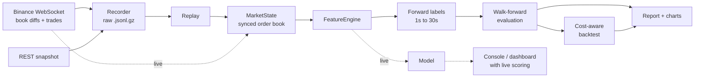

# Order Book Alpha Research: BTC/USDT

[](https://github.com/Q-Bello/Real-time-order-book/actions/workflows/ci.yml)

Does the live Binance BTC/USDT order book predict where the price goes in the next few seconds, and is that prediction worth anything after trading costs?

This project answers that end to end: it records the raw Level 2 book and trade feed, rebuilds a correctly synchronised order book offline, computes microstructure features from the research literature, and evaluates models with walk-forward testing against simple baselines. A cost-aware backtest then measures whether the edge survives crossing the spread and paying fees. The same code runs live, with a console and a dashboard that score every prediction as it happens.

## Key findings

From 4 hours of live BTC/USDT data (143,492 book states, 100,197 trades, about 257 price-level changes per second), evaluated out of sample with 5-fold purged walk-forward testing. Full results: [`reports/REPORT.md`](reports/REPORT.md).

1. **The order book predicts the next few seconds.** At a 5-second horizon, XGBoost reaches 0.50 balanced accuracy against 0.33 for chance, with an information coefficient of 0.47 between its signal and the realised return.
2. **Depth imbalance drives it.** Imbalance over the best 5 levels is the most important feature, followed by level-1 imbalance (the micro-price signal). Volatility mainly helps separate "will move" from "will stay".
3. **The signal is short-lived.** Information coefficient peaks at 2 to 5 seconds and falls by half or more by 30 seconds.
4. **Most of the signal is close to linear.** The full feature set lifts information coefficient from 0.29 (order flow imbalance alone) to about 0.48. XGBoost beats logistic regression at calling the class at 1 to 5 seconds, but not at ranking returns.
5. **Predictive is not the same as profitable.** Trading the out-of-sample signals earns about 0.38 bps per trade at the 5-second horizon (threshold 0.2), a break-even fee of 0.19 bps per side (0.07 to 0.38 across all horizons and thresholds). That is far below what a taker pays, so as a taker strategy it loses money. Capturing it would need passive (maker) execution, which brings its own adverse-selection risk.

Caveat: one 4-hour window covering the Asian morning session. The pipeline combines any number of recordings, so testing other sessions is a matter of recording more.


---

## How it works



Live and offline paths share one `MarketState` and one `FeatureEngine`, so the features a model is trained on are computed exactly as they will be in production.

### 1. Data integrity

- **Raw recording first.** Every message is stored exactly as received. Features and labels are rebuilt by replaying the recording, so experiments are reproducible and new ideas don't need new data.
- **Correct book reconstruction.** Binance's diff stream only describes changes. The book is seeded from a REST snapshot and each diff applied in update-ID order. A missing update is detected immediately and triggers a re-sync, and labels never span the gap.

### 2. Features

| Feature | What it measures | Source |
|---|---|---|
| `imb_l1`, `imb_l5`, `imb_l10` | Depth imbalance over the best 1, 5 and 10 levels. Level 1 is also the micro-price signal: the size-weighted mid equals mid + spread/2 × `imb_l1` | Stoikov (2018) |
| `ofi_l1_{10,50}` | Order flow imbalance at the best level, summed over the last 10 / 50 updates, scaled by typical queue size | Cont, Kukanov & Stoikov (2014) |
| `ofi_ml_{10,50}` | Multi-level OFI across the best 5 levels | Xu, Gould & Howison (2019) |
| `tfi_{1s,5s}` | Aggressor trade-flow imbalance from the live trade stream | |
| `log_trade_vol_5s` | Recent trading activity | |
| `past_ret_{1s,5s}_bps` | Short-term momentum or mean reversion | |
| `rv_bps` | Realised volatility of the mid over the last 50 updates | |
| `spread_ticks`, `log_depth_l10` | Liquidity state | |

Raw price levels are deliberately excluded, so models learn order-flow behaviour rather than the price range of the training period.

### 3. Labels

For each moment *t* and horizon *h* ∈ {1, 2, 5, 10, 30} seconds, the label compares the mid-price at the first update at or after *t + h* with the mid at *t*: **UP**, **DOWN** or **STABLE** (move within half the spread). Labels are computed in a separate step from features, with column names that cannot collide.

### 4. Evaluation

- **Expanding walk-forward**, 5 folds: each fold trains only on data before its test block.
- **Purging:** training rows whose label window reaches into the test block are dropped.
- **Baselines**, so the model is judged against simple alternatives: majority class, a linear model on level-1 OFI alone (the classic benchmark), and logistic regression on all features.
- **Metrics:** accuracy, balanced accuracy, macro F1, log loss and information coefficient (rank correlation between the signal P(UP) − P(DOWN) and the realised return), as mean ± standard deviation across folds.
- **Permutation importance** shows which features drive the predictions.

### 5. Is the edge tradeable?

Out-of-sample signals are traded with rules fixed in advance: enter when |P(UP) − P(DOWN)| exceeds a threshold, hold for the horizon, buy at the ask and sell at the bid. The report gives gross and after-spread return per trade, and the **break-even fee**: the per-side cost at which the average trade makes zero. Comparing that number with real exchange fees is the honest test of whether a predictive signal is a trading strategy.

### 6. Engineering

- Order book on sorted maps: best price in O(1), top *k* levels in O(*k*). Book update and feature latency are measured on every replay and reported (p50 / p99, microseconds).
- Rolling OFI windows maintained as running sums.
- 22 unit and integration tests, including an end-to-end run on a simulated market with a known signal. CI runs lint and tests on every push.

---

## Quickstart

Requires Python 3.10+.

```bash
git clone https://github.com/Q-Bello/Real-time-order-book.git
cd Real-time-order-book
python -m venv .venv && source .venv/bin/activate
pip install -r requirements.txt
```

| Step | Command |
|---|---|
| Record live data (more is better; several sessions can be combined) | `make record MINUTES=120` |
| Build dataset, evaluate, write report | `make research` |
| Live predictions in the console, scored as they resolve | `make live` |
| Live dashboard at http://127.0.0.1:8050 | `make dashboard` |
| Tests and lint | `make test lint` |
| Whole pipeline on simulated data, no network needed | `make demo` |

Each step is also a module, e.g. `python -m lobpred.evaluate --help`.

## Project structure

```
src/lobpred/
  stream.py      live Binance feed with snapshot sync and gap detection
  record.py      raw data recorder
  replay.py      reads recordings back
  book.py        sorted-map order book
  market.py      shared state machine: records -> synced book + trades
  features.py    incremental feature engine
  labels.py      forward-looking multi-horizon labels
  dataset.py     replay -> features -> labels -> Parquet, with latency stats
  evaluate.py    purged walk-forward evaluation, baselines, final models
  backtest.py    cost-aware signal backtest
  report.py      charts and REPORT.md
  live.py        live console predictions with running hit rate
  simulate.py    synthetic market for tests and the demo
dashboard/app.py live Dash dashboard
tests/           unit and end-to-end tests
reports/         generated results (committed)
```

## Limitations

- Results describe the recorded period. Short-horizon relationships shift with volatility regime and time of day, so more and longer recordings make the conclusions stronger.
- The backtest fills at the recorded best bid and ask, with no queue position, latency or market impact.
- Shorts are treated symmetrically for simplicity (as on a perpetual future); fee levels are illustrative.

## What changed in v2

Version 1 (2025) was a single-script prototype. A review found that its labels used information from after the features' timestamp, its OFI and VOI features were always zero (the previous book state was the same object as the current one), the order book was never seeded from a snapshot, and evaluation used a random split. Version 2 is a rebuild that fixes all four and adds the recording, evaluation, backtesting and reporting described above.

## References

- Cont, R., Kukanov, A. and Stoikov, S. (2014). The price impact of order book events. *Journal of Financial Econometrics*.
- Stoikov, S. (2018). The micro-price: a high-frequency estimator of future prices. *Quantitative Finance*.
- Xu, K., Gould, M. D. and Howison, S. D. (2019). Multi-level order-flow imbalance in a limit order book. arXiv:1907.06230.
- López de Prado, M. (2018). *Advances in Financial Machine Learning*. Wiley. (Purged cross-validation.)

## Author

Quddus Bello, BSc Computer Science, Newcastle University · [LinkedIn](https://www.linkedin.com/in/quddus-bello-73482b317/)
