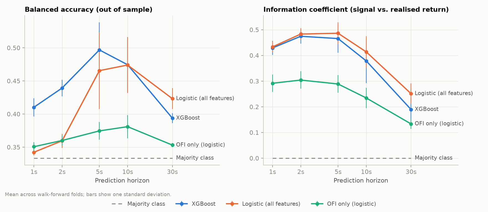
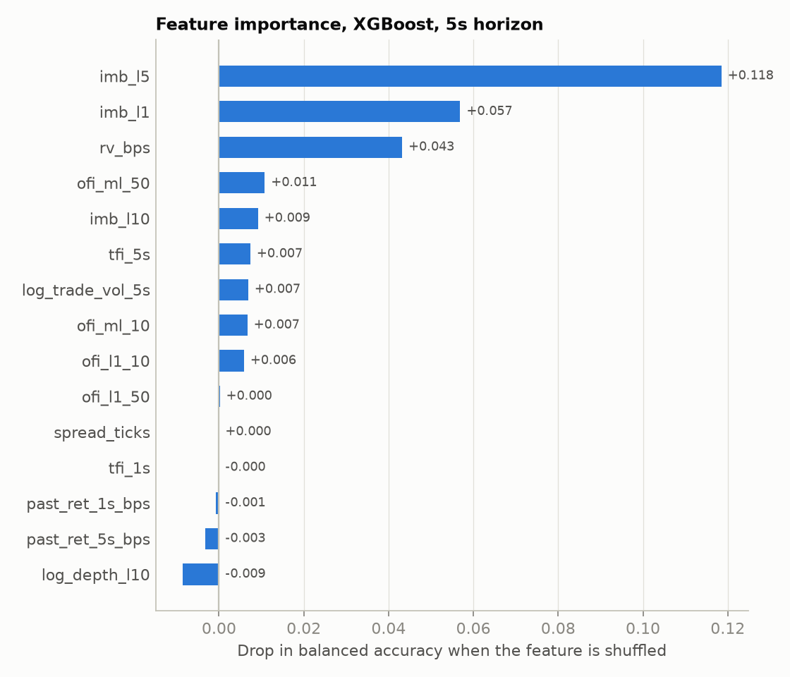
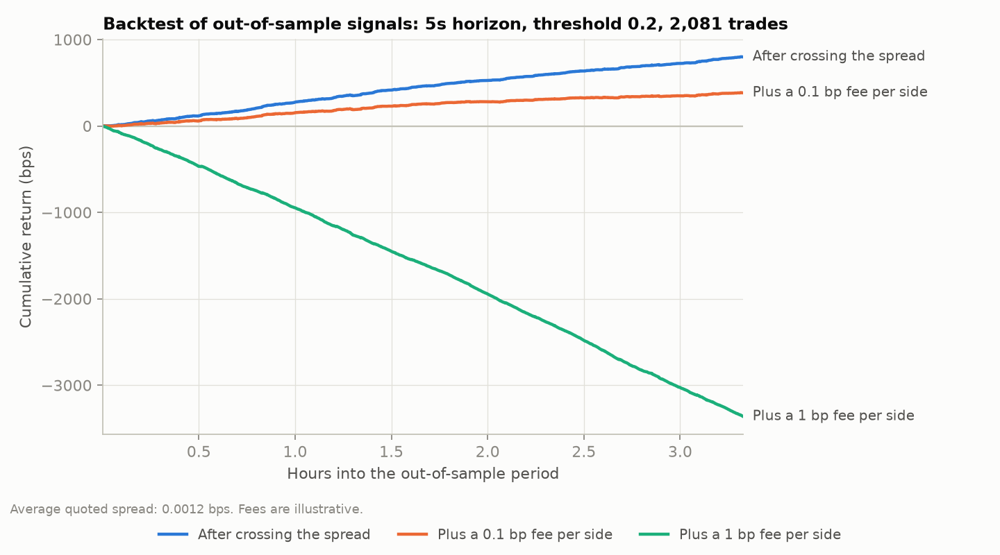

# Results

_Generated 2026-10-14 04:12 UTC by `python -m lobpred.report`._

## Data

| | |
|---|---|
| Rows | 143,492 |
| Hours of data | 4.0 |
| Continuous segments | 1 |
| Book updates per second | 9.97 |
| Price-level changes per second | 257.3 |
| Trades | 100,197 |
| Book update latency (p50 / p99) | 16.2 / 293.8 µs |
| Feature computation latency (p50 / p99) | 44.8 / 77.0 µs |

## Predictive performance

5-fold expanding walk-forward with purging; mean ± std across folds. Balanced accuracy for three classes is 0.333 by chance.

| Horizon | Model | Accuracy | Balanced accuracy | Macro F1 | Log loss | IC |
|---|---|---|---|---|---|---|
| 1s | Majority class | 0.822 ± 0.024 | 0.333 ± 0.000 | 0.301 ± 0.005 | 0.607 ± 0.064 | 0.000 ± 0.000 |
| 1s | OFI only (logistic) | 0.819 ± 0.024 | 0.351 ± 0.007 | 0.338 ± 0.016 | 0.562 ± 0.056 | 0.291 ± 0.034 |
| 1s | Logistic (all features) | 0.821 ± 0.023 | 0.342 ± 0.005 | 0.320 ± 0.012 | 0.490 ± 0.050 | 0.433 ± 0.021 |
| 1s | XGBoost | 0.825 ± 0.025 | 0.410 ± 0.014 | 0.436 ± 0.020 | 0.492 ± 0.057 | 0.429 ± 0.027 |
| 2s | Majority class | 0.702 ± 0.036 | 0.333 ± 0.000 | 0.275 ± 0.009 | 0.838 ± 0.076 | 0.000 ± 0.000 |
| 2s | OFI only (logistic) | 0.705 ± 0.036 | 0.360 ± 0.008 | 0.333 ± 0.020 | 0.784 ± 0.068 | 0.304 ± 0.034 |
| 2s | Logistic (all features) | 0.706 ± 0.035 | 0.359 ± 0.011 | 0.332 ± 0.024 | 0.695 ± 0.070 | 0.483 ± 0.023 |
| 2s | XGBoost | 0.715 ± 0.034 | 0.439 ± 0.012 | 0.463 ± 0.018 | 0.705 ± 0.081 | 0.474 ± 0.029 |
| 5s | Majority class | 0.465 ± 0.055 | 0.333 ± 0.000 | 0.211 ± 0.018 | 1.101 ± 0.074 | 0.000 ± 0.000 |
| 5s | OFI only (logistic) | 0.488 ± 0.054 | 0.374 ± 0.013 | 0.310 ± 0.037 | 1.053 ± 0.073 | 0.289 ± 0.034 |
| 5s | Logistic (all features) | 0.531 ± 0.064 | 0.466 ± 0.058 | 0.459 ± 0.082 | 0.962 ± 0.085 | 0.486 ± 0.043 |
| 5s | XGBoost | 0.544 ± 0.049 | 0.497 ± 0.042 | 0.504 ± 0.049 | 0.987 ± 0.106 | 0.466 ± 0.055 |
| 10s | Majority class | 0.294 ± 0.083 | 0.333 ± 0.000 | 0.149 ± 0.035 | 1.138 ± 0.057 | 0.000 ± 0.000 |
| 10s | OFI only (logistic) | 0.355 ± 0.074 | 0.381 ± 0.018 | 0.275 ± 0.046 | 1.111 ± 0.065 | 0.234 ± 0.040 |
| 10s | Logistic (all features) | 0.484 ± 0.054 | 0.474 ± 0.042 | 0.452 ± 0.042 | 1.043 ± 0.069 | 0.414 ± 0.061 |
| 10s | XGBoost | 0.485 ± 0.044 | 0.474 ± 0.041 | 0.466 ± 0.041 | 1.073 ± 0.102 | 0.378 ± 0.086 |
| 30s | Majority class | 0.487 ± 0.035 | 0.333 ± 0.000 | 0.218 ± 0.011 | 0.911 ± 0.051 | 0.000 ± 0.000 |
| 30s | OFI only (logistic) | 0.509 ± 0.025 | 0.353 ± 0.003 | 0.304 ± 0.014 | 0.903 ± 0.051 | 0.133 ± 0.020 |
| 30s | Logistic (all features) | 0.583 ± 0.027 | 0.423 ± 0.016 | 0.416 ± 0.019 | 0.876 ± 0.036 | 0.251 ± 0.040 |
| 30s | XGBoost | 0.537 ± 0.025 | 0.394 ± 0.007 | 0.385 ± 0.007 | 0.918 ± 0.053 | 0.190 ± 0.045 |

## What drives the 5s prediction

Permutation importance on the final fold (drop in balanced accuracy when shuffled):

- `imb_l5`: +0.1185
- `imb_l1`: +0.0569
- `rv_bps`: +0.0432
- `ofi_ml_50`: +0.0108
- `imb_l10`: +0.0092

## Is the edge tradeable?

Out-of-sample XGBoost signals traded with fixed rules: enter when |P(UP) − P(DOWN)| ≥ threshold, hold for the horizon, cross the spread both ways. Break-even fee is the per-side cost at which the average trade makes zero.

| Horizon | Threshold | Trades/hour | Hit rate | Gross bps/trade | After spread bps/trade | Break-even fee (bps/side) |
|---|---|---|---|---|---|---|
| 1s | 0.1 | 2089.3 | 26.4% | +0.149 | +0.148 | +0.074 |
| 1s | 0.2 | 1287.5 | 37.5% | +0.207 | +0.205 | +0.103 |
| 1s | 0.3 | 837.6 | 48.0% | +0.269 | +0.268 | +0.134 |
| 1s | 0.5 | 393.4 | 64.7% | +0.359 | +0.357 | +0.179 |
| 2s | 0.1 | 1462.4 | 31.8% | +0.207 | +0.206 | +0.103 |
| 2s | 0.2 | 1098.7 | 40.0% | +0.266 | +0.265 | +0.132 |
| 2s | 0.3 | 816.3 | 49.4% | +0.331 | +0.329 | +0.165 |
| 2s | 0.5 | 471.2 | 64.6% | +0.448 | +0.447 | +0.223 |
| 5s | 0.1 | 689.1 | 43.5% | +0.310 | +0.309 | +0.154 |
| 5s | 0.2 | 625.1 | 48.7% | +0.385 | +0.384 | +0.192 |
| 5s | 0.3 | 548.5 | 54.4% | +0.461 | +0.460 | +0.230 |
| 5s | 0.5 | 385.1 | 67.9% | +0.626 | +0.625 | +0.313 |
| 10s | 0.1 | 353.4 | 51.7% | +0.386 | +0.385 | +0.192 |
| 10s | 0.2 | 338.1 | 54.1% | +0.470 | +0.469 | +0.235 |
| 10s | 0.3 | 313.4 | 59.8% | +0.575 | +0.574 | +0.287 |
| 10s | 0.5 | 253.0 | 68.6% | +0.762 | +0.761 | +0.380 |
| 30s | 0.1 | 119.5 | 56.9% | +0.502 | +0.501 | +0.251 |
| 30s | 0.2 | 118.0 | 59.9% | +0.610 | +0.609 | +0.304 |
| 30s | 0.3 | 114.7 | 60.1% | +0.515 | +0.514 | +0.257 |
| 30s | 0.5 | 95.7 | 58.8% | +0.603 | +0.601 | +0.301 |

## Caveats

- Results cover the recorded period only; short-horizon relationships change with market regime.
- The backtest assumes fills at the recorded best bid/ask with no queueing, latency or market impact.
- Fee levels are illustrative. Shorts are treated symmetrically, as on a perpetual future.
